# TuningSuites
TxSuite: T5Suite, T7Suite and T8Suite in one program

TxSuite is an Open Source tool for tuning Trionic 5, 7 and 8 ECU's.

You can tune how the software behaves to get more performance out of the car, and adjust it for hardware changes like high performance injectors.

TxSuite also has realtime viewing and logging, and an airmass result viewer that predicts how a tune will behave.

Installer packages and other information for the original suites are here:
http://www.txsuite.org

# TxSuite for Windows, Linux and macOS

T5Suite, T7Suite and T8Suite have been rebuilt on .NET 10 and Avalonia, without the commercial components the old suites needed, so they run on Windows, Linux and macOS. The three are merged into one program, TxSuite. Open a T5, T7 or T8 binary and TxSuite works on it the way that ECU's suite did: the same files read, edited and written, the same maps, tools and realtime panel. It talks to the ECU through [TrionicCANLib](https://github.com/roffe/Trionic), the library of the Trionic CAN Flasher.

[PORTING.md](PORTING.md) tracks what has been ported and every deliberate difference from the old suites. The old .NET Framework suites are kept in [OldSuites](OldSuites) for reference.

## One program for three ECU's

- One window for all three. The file you open decides the ECU. Opening a file of another ECU closes the one before, unsaved maps are asked about first.
- One menu. What every ECU has is always there, an ECU's own items show while one of its files is open. Want the old suites' ribbon back? Settings → Show ribbon bar instead of menus.
- Connecting to the ECU needs an open file, the file tells TxSuite which ECU it's talking to.
- One settings dialog: Common, Logging and a tab per ECU. The first start takes over the settings of T5Suite, T7Suite and T8Suite once, their Recent lists merged into one.
- Lookup partnumber finds the partnumbers of all three ECU's, and its list has a tab per ECU.
- Help has the user manual and the Trionic documentation of every ECU.

Settings and log files are in `%APPDATA%\MattiasC\TxSuite` on Windows and `~/.config/MattiasC/TxSuite` on Linux. Settings → Logging decides which log files get written, at what level and for how long.

TxSuite supports the same interfaces as the flasher (on a T5 it talks to the ECU's P-bus):

| Interface | Windows | Linux | macOS |
|---|---|---|---|
| Lawicel CANUSB | Lawicel CANUSB DLL driver | FTDI serial port (`/dev/ttyUSB*`) | FTDI serial port (`/dev/cu.usbserial-LW*`) |
| CombiAdapter | libusb (WinUSB driver) | libusb + udev rule | libusb |
| OBDLink SX / EX, ELM327 | serial port | serial port | serial port |
| Just4Trionic | serial port | serial port | serial port |
| SLCAN | serial port | serial port | serial port |
| Kvaser HS | Kvaser CANlib driver | Kvaser linuxcan | not supported |
| J2534 (Beta) | vendor DLL (32-bit, from the registry) | vendor `.so` from `~/.passthru/*.json` | not supported |
| Wideband lambda (realtime) | serial port | serial port | serial port |

## Screenshots

TxSuite has a light and a dark skin (Skin menu, or follow the system's theme).

| Light | Dark |
|---|---|
| 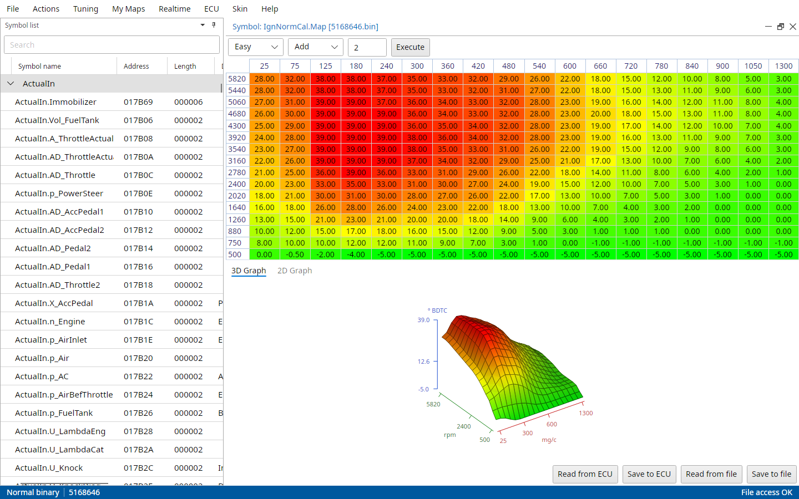 | 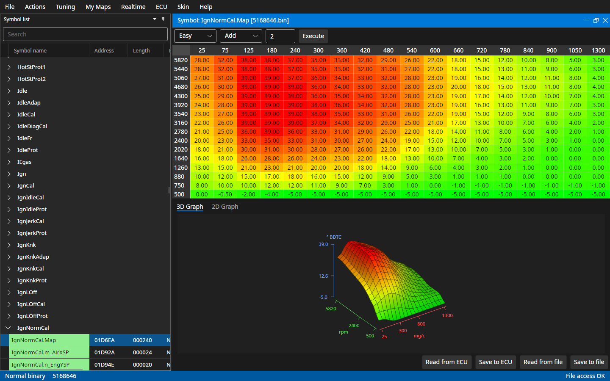 |
| 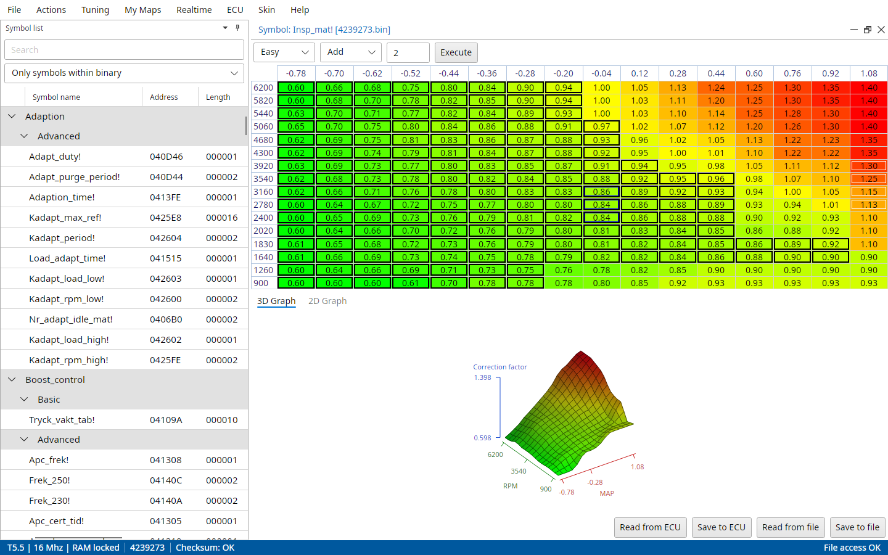 | 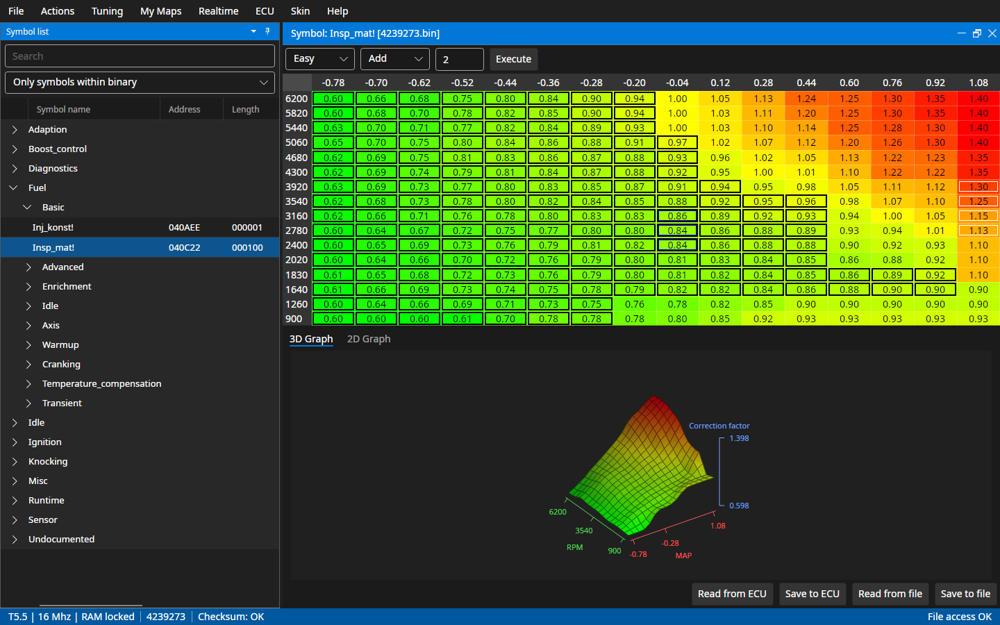 |
| 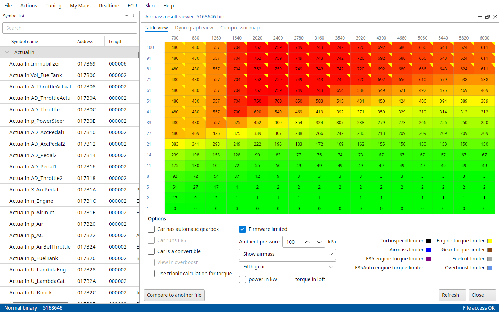 | 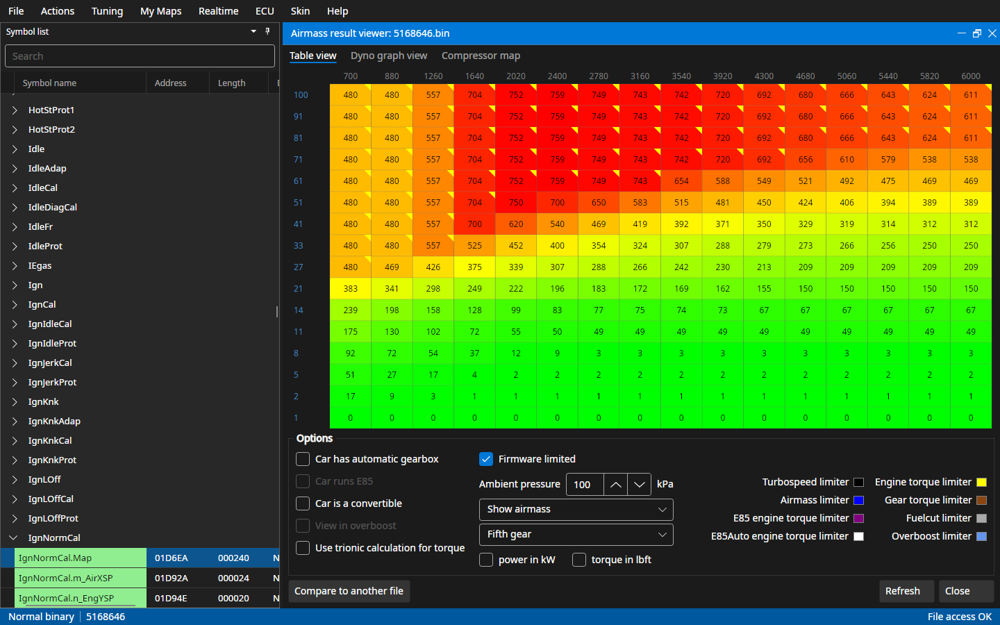 |
| 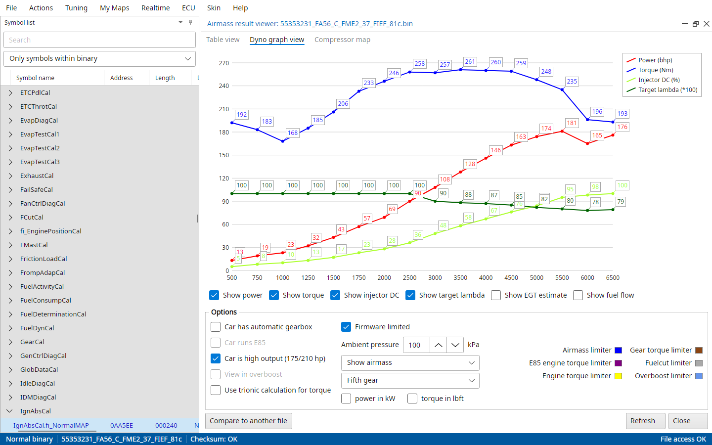 | 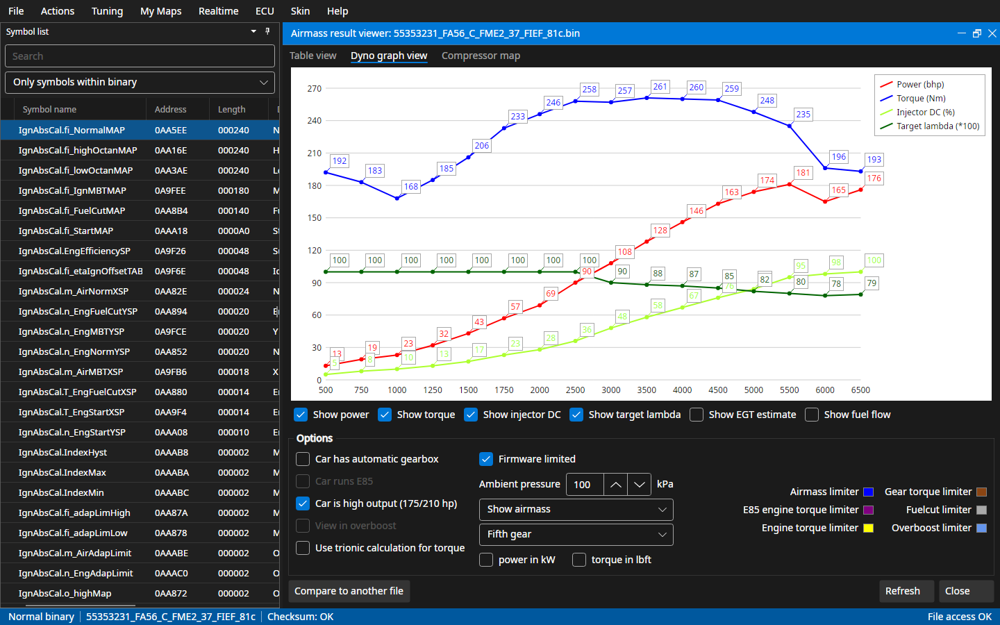 |
| 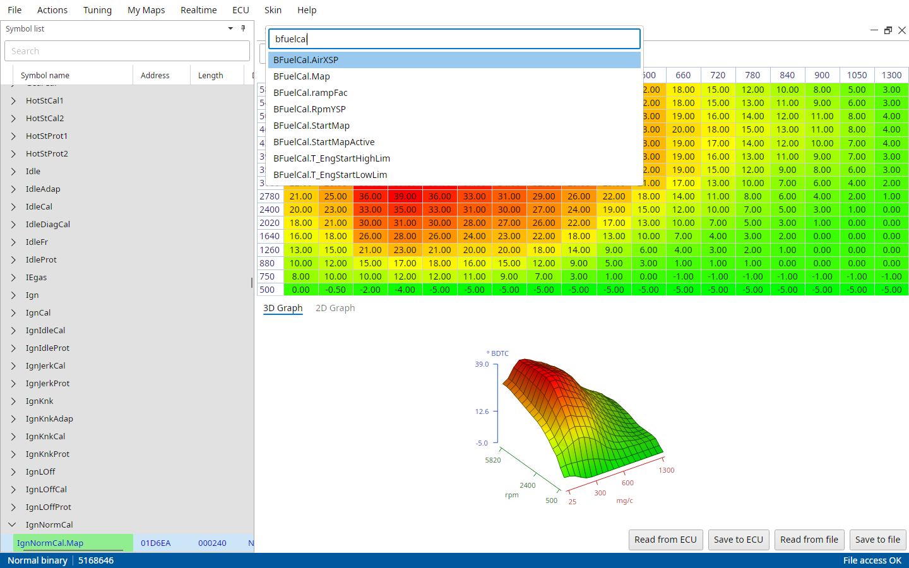 | 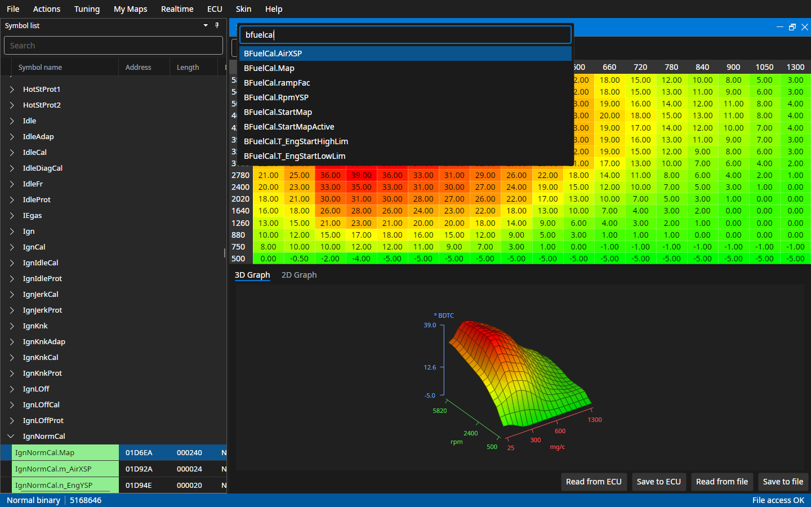 |
|  | 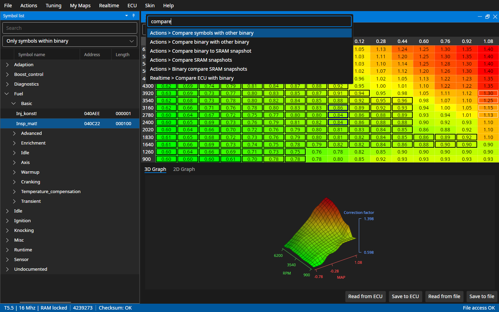 |

A T7's ignition map, a T5's fuel map, a T7's airmass result and a T8's dyno graph, all on stock binaries. Like in VS Code, Ctrl+P opens a symbol by any part of its name and Ctrl+Shift+P runs any menu command (Cmd on macOS). The firmware and settings dialogs and both palettes for each ECU are in [docs/screenshots](docs/screenshots), `bash docs/screenshots/generate.sh` renders them all again from TxSuite.

## System Requirements
- Windows 10 or Windows 11. The setup brings its own .NET runtime.
- Linux x64 or arm64 with a desktop (X11 or XWayland).
- macOS on Apple silicon or Intel.

The adapters still need their own drivers, see [Adapter setup](https://github.com/roffe/Trionic#adapter-setup) in the flasher's README.

## Installation

The newest TxSuite and TxExtras are on [one page](https://github.com/roffe/TuningSuites/releases/latest). All downloads are on the [releases page](https://github.com/roffe/TuningSuites/releases): the `Txsuite_v…` releases, and `Txsuite_nightly` with the latest build. The stock binaries of all three ECUs (Compare to original file, Lookup partnumber, Create binary from TIS file) are a separate download, TxExtras: the `Txextras_v…` releases. They go into `Binaries\T5`, `Binaries\T7` and `Binaries\T8` in TxSuite's folder. TxSuite's packages also carry T8's Tuning Wizard packs in `TuningPacks`.

### Windows
Run TxSuiteSetup.exe. It installs to `Program Files (x86)\MattiasC\TxSuite`, next to any old T5Suite, T7Suite or T8Suite (it replaces none of them), and asks whether `.bin` files should open in TxSuite; if you once picked another program with "Always", Windows keeps that one until you pick TxSuite under Open with. Then TxExtrasSetup.exe puts the stock binaries into TxSuite's folder. Running the setup of a newer build over an existing installation upgrades it.

Rather not install it? TxSuite-win-x86.zip runs from wherever you unpack it, unpack TxExtras.zip into the `TxSuite` folder for the stock binaries. It doesn't open `.bin` files by itself, and its update check opens the release page instead of downloading the setup.

### Linux
Download TxSuite-linux-x64.tar.gz (or -linux-arm64) and run it from where you extracted it; unpack TxExtras.zip into the `TxSuite` folder for the stock binaries:

    tar xzf TxSuite-linux-x64.tar.gz
    ./TxSuite/TxSuite

`./TxSuite/install-desktop.sh` adds TxSuite to the application menu and to Open with for `.bin` files, for your user only (run it again after moving the folder). The CombiAdapter needs libusb and the udev rule next to the program:

    sudo cp TxSuite/70-txsuite.rules /etc/udev/rules.d/
    sudo udevadm control --reload && sudo udevadm trigger

### macOS
Download TxSuite-osx-arm64.zip (Apple silicon) or -osx-x64 (Intel). The build is not signed, so clear the quarantine flag after extracting it, then start it from Terminal or by double-clicking TxSuite in Finder:

    unzip TxSuite-osx-arm64.zip
    xattr -dr com.apple.quarantine TxSuite
    ./TxSuite/TxSuite

## Updates
TxSuite looks for a newer `Txsuite_v…` release when it starts and from Help → Check for updates, and shows the result in the status bar. When there is one it asks; OK downloads the setup on Windows and opens the release page elsewhere (and for the Windows zip).

## Disclaimer
This is Open Source software that pokes around in your car's control system. The authors of the tools shall not be held accountable for how you decide to use the tools. If you are not careful, you can easily brick your car with these tools so please use this software with care.

## Building from source
You need the [.NET 10 SDK](https://dotnet.microsoft.com/download/dotnet/10.0). TrionicCANLib comes from the `Trionic` submodule:

    git clone https://github.com/roffe/TuningSuites
    cd TuningSuites
    git submodule init Trionic
    git submodule update
    dotnet test T7CoreTest
    dotnet test T8CoreTest
    dotnet test T5CoreTest
    dotnet test TxSuiteTest
    dotnet run --project TxSuite

`-p:TrionicDir=../Trionic` builds against another checkout of roffe/Trionic instead, for working on both.

How the code is laid out: TxSuite is the program, its window, menus and settings dialog. Each ECU has a core with its file, map and ECU code (T5Core, T7Core, T8Core) and a library with its part of the program (T5App, T7App, T8App). SuiteCore and SuiteApp are shared by all three and know no ECU. The tests sit next to what they test (T7CoreTest, T7AppTest, TxSuiteTest, ...).

A self-contained build that runs on a machine without .NET, for `win-x86`, `linux-x64`, `linux-arm64`, `osx-arm64` or `osx-x64`:

    dotnet publish TxSuite/TxSuite.csproj -c Release -r linux-x64 --self-contained -o out/TxSuite

The Windows build is 32-bit (`win-x86`) because most J2534 drivers and the Lawicel CANUSB driver only come as 32-bit DLLs, so on Windows `dotnet run` needs the x86 .NET 10 runtime installed.

A Debug build links `Binaries/T5`, `T7` and `T8` in the output folder to the repository's T5Binaries, T7Binaries and T8Binaries (Linux and macOS), so `dotnet run` finds the stock binaries.

The Windows setups are built with [Inno Setup 6](https://jrsoftware.org/isinfo.php), TxSuite's from a `win-x86` publish folder with libusb-1.0.dll added to it (`MinGW32/dll/libusb-1.0.dll` from the [libusb release](https://github.com/libusb/libusb/releases)):

    ISCC /DPublishDir=C:\path\to\out\TxSuite SetupTx\TxSuite.iss
    ISCC /DVersion=1.0.0 SetupTx\TxExtras.iss

The release builds are made by [.github/workflows/build.yml](.github/workflows/build.yml) and [.github/workflows/extras.yml](.github/workflows/extras.yml): every push to `master` updates the `Txsuite_nightly` pre-release, a `Txsuite_v*` tag makes a TxSuite release and a `Txextras_v*` tag a TxExtras release.

## Versioning and releasing
No file holds the version. TxSuite takes it from its nearest `Txsuite_vX.Y.Z` tag ([Directory.Build.props](Directory.Build.props)). The window title shows it:

| Build | Version |
|---|---|
| A tagged commit, for example `Txsuite_v1.0.0` | `1.0.0` |
| Commits after the tag (nightlies, local builds) | `1.0.0-<first 9 characters of the commit sha>` |
| Local build with uncommitted changes | `1.0.0-<sha>-dirty` |
| A tag with a label, for example `Txsuite_v1.1.0-beta` | `1.1.0-beta`, after it `1.1.0-beta-<sha>` |
| No git, no tag or a shallow clone | `0.0.0-<sha>`, with a build warning |

The file and assembly version, which the update check and the setup use, is the tag's numbers padded to four parts (`1.0.0.0`).

To make a release, tag the commit and push the tag:

    git tag Txsuite_v1.0.0
    git push origin Txsuite_v1.0.0

TxExtras is versioned by its own `Txextras_vX.Y.Z` tags.

To build without git, for example from a source archive, pass the version: `dotnet build -p:Version=1.0.0`.
